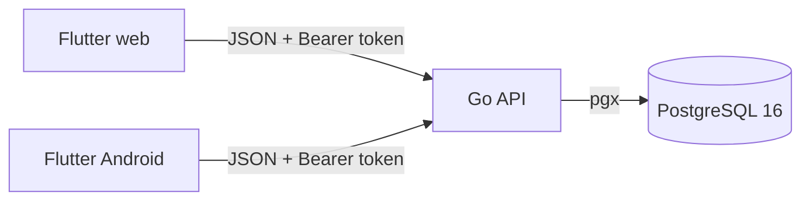

<h1 align="center">ProductionFlow</h1>

<p align="center">
  <b>Shoot coordination for small film crews.</b><br>
  One call sheet everyone trusts — and, before a schedule change is confirmed,<br>
  exactly who and what it affects.
</p>

<p align="center">
  
  
  
  
</p>

## The problem

A crew of 5–15 people runs a shoot through Telegram, Google Sheets and Drive.
Call times change in a chat and someone misses it. People shoot from an old
version of the script. And when a shooting day moves, nobody can say which
scenes and which people that affects — so the producer calls everyone by hand,
and still forgets someone.

## The idea

**Everything hangs off a shooting day.** Scenes belong to a day, people belong
to scenes, so the app always knows who is needed where. Change a day, and
ProductionFlow shows who and what it affects *before* you confirm — then tells
only those people.

That one mechanic is the product. Everything else either feeds it or is out of
scope ([the boundary is written down](CLAUDE.md#scope--do-not-build-these)).

## What works today

Release 1 is built on both sides: the API and the app for web and Android.

| | Story | API | App |
| --- | --- | :-: | :-: |
| **R1 — Core** | Register and log in | ✅ | ✅ |
| | Create a project, invite the crew by link | ✅ | ✅ |
| | Join from a link as crew or cast | ✅ | ✅ |
| | Add a shooting day: date, call time, location | ✅ | ✅ |
| | Today's call sheet on a phone | ✅ | ✅ |
| **R2 — Impact** | Scenes on a day, with the people needed in each | ✅ | ✅ |
| | See who a change affects before confirming it | ✅ | ✅ |
| | Confirm the change; it is recorded in the change feed | next | next |
| **R3 — Stretch** | Notify only the people affected | planned | planned |
| | "My schedule": only my own days | planned | planned |

A producer builds each day on its call sheet: adds scenes, picks who is needed
in each and who is on set all day — including people added by name who never
install the app. "Move this day" then shows exactly who and what the move
affects. Confirming it is the next step (US-08); until then the preview is
look-only and changes nothing.

Not deployed yet. The plan is free tiers all the way — Neon for Postgres, Render
for the API, Cloudflare Pages for the web app — and it is written up in
[docs/architecture.md](docs/architecture.md#6-hosting-and-deployment).

## Run it

One command, from the repo root:

```sh
docker compose up --build
```

Then open **http://localhost:3000**. That starts Postgres, applies the
migrations, starts the API, and serves the web app — in that order. (Partway
through it prints `productionflow-migrate-1 exited with code 0`. That is the
migrations finishing, not a failure.)

| Service | Where |
| --- | --- |
| Web app | http://localhost:3000 |
| API | http://localhost:8080 — try `curl localhost:8080/api/health` |
| Postgres | `localhost:5432`, user and password `productionflow` |

Ports already taken? `POSTGRES_PORT=5433 WEB_PORT=3001 docker compose up --build`

### Working on it

Docker is for running the whole thing. For the edit loop, run each half directly:

```sh
cd backend && make dev            # API on :8080, Postgres in Docker
cd client && flutter run -d chrome   # the app, with hot reload
```

No server at hand? The app runs on sample data alone:

```sh
cd client && flutter run -d chrome --dart-define=USE_MOCK=true
```

More in [backend/README.md](backend/README.md) and
[client/README.md](client/README.md).

## How it fits together



| | |
| --- | --- |
| **App** | Flutter, one codebase for Android and web. Riverpod, go_router, dio |
| **API** | Go standard library `net/http` — no framework, no ORM. pgx for Postgres |
| **Database** | PostgreSQL 16, plain SQL migrations |
| **Auth** | bcrypt passwords, 7-day JWT |

Three decisions shape most of the code:

- **A change is two steps, never one.** Preview shows who is affected and writes
  nothing; apply re-checks that the preview is still true, then commits. A
  shooting day's date, time and place can only change this way.
- **A call time is not a timestamp.** It is "07:30 on the 4th", stored as a date
  and a time and never converted between time zones — on the server or in the
  app.
- **The contract comes first.** [docs/api.md](docs/api.md) changes before the
  code, and the app can run against fixtures made from it.

The reasoning behind these, the data model and the hosting plan are in
[docs/architecture.md](docs/architecture.md).

## Repository

| Path | What |
| --- | --- |
| [`backend/`](backend/README.md) | Go API and SQL migrations |
| [`client/`](client/README.md) | Flutter app — Android and web |
| [`docs/api.md`](docs/api.md) | The API contract: every endpoint, with its status |
| [`docs/architecture.md`](docs/architecture.md) | Layers, schema, auth, the impact flow, hosting, decisions |
| [`CLAUDE.md`](CLAUDE.md) | Domain model, conventions and the scope boundary |
| [`docker-compose.yml`](docker-compose.yml) | The whole stack in one file |

## Tests

```sh
cd backend && go test ./...       # rules, handlers, auth
cd client && flutter analyze && flutter test
```

The backend also has tests that run against a real Postgres; they are skipped
unless `TEST_DATABASE_URL` is set — see
[`backend/internal/store/store_test.go`](backend/internal/store/store_test.go).

## Team

Built for **IT Project Management** at Kazakh-British Technical University,
Fall 2026.

| | |
| --- | --- |
| **Zhanibek** | Backend and DevOps |
| **Almas** | Flutter client |
| **Zhaksylyk** | Project manager |
