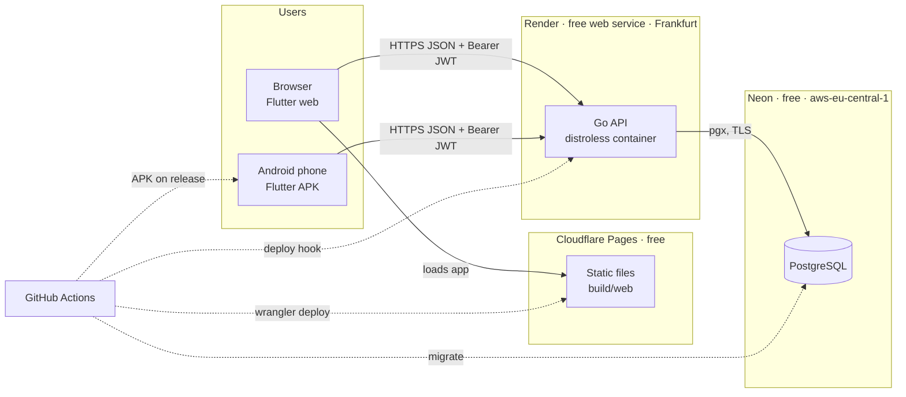
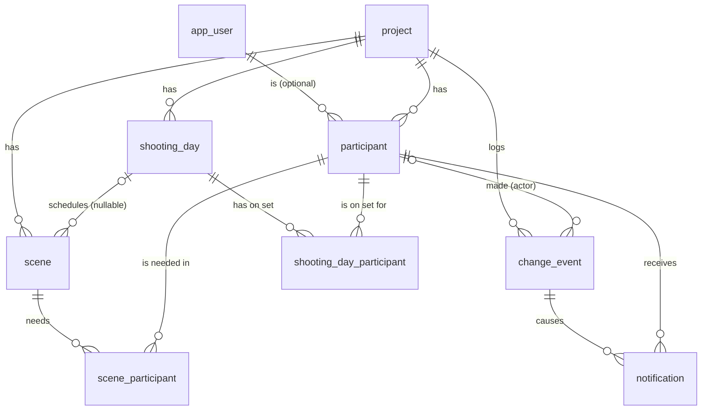

# ProductionFlow — Architecture

How the whole thing fits together: backend, client, database, hosting. The API
contract itself lives in [`api.md`](api.md); this document explains the shape
behind it and the decisions that produced it.

Read this before starting a feature. If you are about to do something this
document says not to, change the document first, in its own PR, and say why.

Last revised: 2 November 2026.

---

## 1. The system in one picture



Three moving parts, each on a free tier, all in or near Frankfurt (the closest
region all three offer to Almaty):

| Part | Runs on | Why there |
| --- | --- | --- |
| Flutter web (static files) | Cloudflare Pages | Static hosting with a global CDN; nothing to keep alive |
| Go API (Docker image) | Render free web service | Builds from our existing `backend/Dockerfile`, no card required |
| PostgreSQL 16 | Neon free | Free forever, does not expire, scales to zero |

Locally it is still exactly one command — `docker compose up --build` — with the
web container proxying `/api` to the API, as today. Production differs in one way
that matters: the web app and the API are on **different origins**, so the API
needs CORS (section 4.2).

---

## 2. Repository layout

What exists today is marked ✓. Everything else is planned and gets created by
the story that needs it, not ahead of time.

```
ProductionFlow/
  CLAUDE.md                        ✓ rules for working in the repo
  docker-compose.yml               ✓ local stack: postgres, migrate, api, web
  docs/
    api.md                         ✓ the contract (rewritten with this doc)
    architecture.md                ✓ this file
  .github/workflows/
    ci.yml                           PR checks: vet, fmt, test, analyze
    deploy.yml                       main: migrate → deploy API → deploy web
    release-apk.yml                  tag v*: build signed APK → GitHub Release
  backend/
    cmd/api/main.go                ✓ wiring only
    internal/
      config/                      ✓ env → Config
      http/                        ✓ router, middleware, errors, health
        auth_handlers.go             US-01
        project_handlers.go          US-02, US-03
        day_handlers.go              US-04, US-05
        scene_handlers.go            US-06
        change_handlers.go           US-07, US-08
        me_handlers.go               US-05, US-09, US-10
        cors.go                      prod only
      domain/                      ✓ (empty) pure rules, no SQL, no HTTP
        impact.go                    who/what a change affects — the core
        diff.go                      field diffs for change_event
        validate.go                  input rules shared by handlers
      auth/                        ✓ (empty)
        password.go                  bcrypt
        jwt.go                       issue / verify access tokens
        previewtoken.go              sign / verify impact preview tokens
      store/                       ✓ pool + Ping
        tx.go                        WithTx helper
        users.go, projects.go, participants.go,
        days.go, scenes.go, changes.go, notifications.go
    migrations/                    ✓ 0001_init
  client/
    lib/
      main.dart                    ✓
      core/
        api_client.dart            ✓ dio, base URL, error envelope
        router.dart                ✓ go_router
        theme.dart                 ✓
        mock/                      ✓ fixtures + MockApi
        backend.dart                 abstract interface both APIs implement
        real_api.dart                dio-backed implementation
        session.dart                 token storage + current user
        models/                      json_serializable classes
      features/
        landing/                   ✓
        app_shell/                 ✓
        auth/                        US-01
        projects/                    US-02
        invite/                      US-03
        today/                       US-05
        shooting_day/                US-04 call sheet + day list
        scenes/                      US-06
        changes/                     US-07 preview sheet, US-08 feed
        my_schedule/                 US-10
        notifications/               US-09
    web/
      _headers                       Cloudflare Pages cache rules
```

---

## 3. Domain model and database

### 3.1 Entity diagram



### 3.2 Tables

`0001_init` already created the first six. Three more are needed for the MVP;
CLAUDE.md asks for new tables to be called out explicitly, so here they are with
the reason for each.

| Table | Status | Purpose |
| --- | --- | --- |
| `project` | ✓ 0001 | One production. Gains `invite_code` in 0002 |
| `shooting_day` | ✓ 0001 | The central entity: `shoot_date` + `call_time` + `location` |
| `scene` | ✓ 0001 | `shooting_day_id` nullable — unscheduled scenes exist |
| `participant` | ✓ 0001 | A person in a project with a role. Gains nullable `user_id` in 0002 |
| `scene_participant` | ✓ 0001 | Who is needed in which scene |
| `change_event` | ✓ 0001 | Append-only log, jsonb diff |
| **`app_user`** | **new, 0002** | An account: email + password hash. Needed for US-01. Separate from `participant` because one person is in many projects, and because the grooming session decided **a participant can exist without an account** (cast who never install anything) |
| **`shooting_day_participant`** | **new, 0002** | People on set for the whole day regardless of scene — the gaffer, the sound recordist. Without it the second half of the impact rule ("∪ participants assigned directly to the day") cannot be computed. This resolves the open question in the old `api.md` |
| **`notification`** | **new, 0003** | In-app notice to one participant about one change event. Needed for US-09 |

Deliberately **not** in the MVP schema, matching the charter's out-of-scope list:
`material`, `material_version`, `task`, `equipment`. CLAUDE.md mentions the first
three as part of the long-term model; they get migrations only if they are ever
pulled into a sprint.

### 3.3 Migration plan

One migration per release. `shooting_day_participant` goes in with R1 rather than
R2 because the call sheet (US-05) already shows who is on set all day; an empty
table costs nothing and saves the call sheet from changing shape later.

**`0002_accounts_invites_day_crew`** (R1: US-01..US-05)

```sql
CREATE TABLE app_user (
    id            uuid        PRIMARY KEY DEFAULT gen_random_uuid(),
    email         text        NOT NULL CHECK (position('@' in email) > 1),
    password_hash text        NOT NULL,
    display_name  text        NOT NULL CHECK (length(btrim(display_name)) > 0),
    created_at    timestamptz NOT NULL DEFAULT now(),
    updated_at    timestamptz NOT NULL DEFAULT now()
);
CREATE UNIQUE INDEX app_user_email_idx ON app_user (lower(email));

-- Nullable on purpose: a participant without an account is a normal case.
ALTER TABLE participant
    ADD COLUMN user_id uuid REFERENCES app_user (id) ON DELETE SET NULL;
CREATE UNIQUE INDEX participant_project_user_idx
    ON participant (project_id, user_id) WHERE user_id IS NOT NULL;

-- One reusable code per project (grooming: links are reusable, no expiry).
-- 32 hex chars from a random UUID: 122 bits, unguessable. A volatile default
-- is evaluated per row, so existing projects each get their own code too.
ALTER TABLE project
    ADD COLUMN invite_code text NOT NULL DEFAULT replace(gen_random_uuid()::text, '-', '');
CREATE UNIQUE INDEX project_invite_code_idx ON project (invite_code);

-- People on set for the whole day, not tied to a scene.
CREATE TABLE shooting_day_participant (
    shooting_day_id uuid        NOT NULL REFERENCES shooting_day (id) ON DELETE CASCADE,
    participant_id  uuid        NOT NULL REFERENCES participant (id) ON DELETE CASCADE,
    created_at      timestamptz NOT NULL DEFAULT now(),
    PRIMARY KEY (shooting_day_id, participant_id)
);
CREATE INDEX shooting_day_participant_participant_idx
    ON shooting_day_participant (participant_id);
```

**`0003_notifications`** (R3: US-09)

```sql
CREATE TABLE notification (
    id                       uuid        PRIMARY KEY DEFAULT gen_random_uuid(),
    recipient_participant_id uuid        NOT NULL REFERENCES participant (id) ON DELETE CASCADE,
    change_event_id          uuid        NOT NULL REFERENCES change_event (id) ON DELETE CASCADE,
    created_at               timestamptz NOT NULL DEFAULT now(),
    read_at                  timestamptz,
    UNIQUE (recipient_participant_id, change_event_id)
);
CREATE INDEX notification_recipient_unread_idx
    ON notification (recipient_participant_id, created_at DESC)
    WHERE read_at IS NULL;
```

### 3.4 Invariants

These hold everywhere; code reviews check them.

- **IDs** are UUID v4, generated by Postgres (`gen_random_uuid()`).
- **Instants** are `timestamptz`, stored UTC, sent as RFC 3339 with `Z`.
- **A call time is wall-clock.** `shoot_date date` + `call_time time`. Never
  combined into a timestamp, never converted between time zones — 07:00 in
  Almaty is 07:00 on the call sheet, full stop. In Go these are plain strings
  validated as `2006-01-02` and `15:04`; in Dart they are strings too (section 5.6).
- **`change_event` is append-only.** No `UPDATE`, no `DELETE`, ever.
- **A shooting day's date, call time and location change only through
  `/api/changes/apply`.** There is no PATCH for those fields. This is what makes
  the impact preview impossible to bypass.
- **`updated_at` is set by the store on every UPDATE** (`SET updated_at = now()`).
  The preview token relies on it to detect a stale preview.

---

## 4. Backend

### 4.1 Layers

The layout from CLAUDE.md, with the rule for each layer stated as a test you can
apply in review:

| Layer | May import | Must not | Test |
| --- | --- | --- | --- |
| `cmd/api` | everything | contain logic | Could this line be in `internal/`? Then it should be |
| `internal/http` | `domain`, `store`, `auth` | contain SQL or business rules | Handlers parse → call → encode. Nothing else |
| `internal/domain` | stdlib only | touch the DB, HTTP, time.Now(), randomness | Every function is testable with plain values |
| `internal/store` | `pgx`, `domain` types | decide anything | One query per method, named after what it returns |
| `internal/auth` | stdlib, `jwt`, `bcrypt` | know about projects | Pure crypto helpers |

The rule that matters most: **the impact computation lives in `domain` and takes
already-loaded data as arguments.** The store loads a day, its scenes, and the
links; `domain.Impact(...)` decides who is affected. That is what makes US-07
unit-testable without Postgres, and it is the one place a bug would make the
product lie to its users.

### 4.2 Request lifecycle

Middleware, outermost first:

```
recoverPanic → requestLogger → cors (prod) → mux → [requireAuth] → handler
```

- `recoverPanic`, `requestLogger` — already exist.
- `cors` — new. Origins from `CORS_ALLOWED_ORIGINS` (comma-separated, exact
  match). Allows `Authorization` and `Content-Type`, methods
  `GET, POST, PUT, PATCH, DELETE`, answers preflight `OPTIONS` with 204 and
  `Access-Control-Max-Age: 600`. No cookies are used, so no
  `Allow-Credentials` and no CSRF surface. Locally the list is empty and the
  middleware is a no-op, because nginx makes everything same-origin.
- `requireAuth` — wraps every route except `/api/health`, `/api/auth/*` and
  `GET /api/invites/{code}` (so the join page can name the project). Reads
  `Authorization: Bearer <jwt>`, verifies it, puts the user id in the request
  context. Missing or invalid → `401 unauthorized`.

Project-scoped handlers then call one helper before doing anything:

```go
// membership loads the caller's participant row in this project.
// Not a member → 404 project_not_found (we do not confirm the project exists).
p, err := h.membership(ctx, userID, projectID)

// and for writes:
if p.Role != domain.RoleProducer { return forbidden }
```

### 4.3 Auth

**Passwords.** `golang.org/x/crypto/bcrypt`, cost 10. Not higher: the free
Render instance has a fraction of a CPU, and cost 12 makes a login take seconds.
Minimum length 8, maximum 72 bytes (bcrypt's limit — longer is rejected, not
silently truncated).

**Access tokens.** JWT, HS256, signed with `JWT_SECRET`. Claims: `sub` (user id),
`iat`, `exp`. Lifetime 7 days (`JWT_TTL_HOURS=168`). There is no refresh flow in
the MVP — a week is long enough that nobody gets logged out mid-shoot, short
enough that a leaked token does not live forever. On 401 the client drops the
token and shows the login screen.

**Roles and permissions.** A role belongs to the *participant*, not the user —
the same person can produce one film and be crew on another.

| Action | producer | crew | cast |
| --- | :-: | :-: | :-: |
| Read project, days, call sheets, scenes, participants, change feed | ✓ | ✓ | ✓ |
| See the project's invite code | ✓ | | |
| Add days, scenes, participants; attach people to scenes and days | ✓ | | |
| Preview and apply changes | ✓ | | |
| Read own notifications and own schedule | ✓ | ✓ | ✓ |

Joining by invite gives `crew` or `cast` — the joiner picks. `producer` is only
the project's creator. Promoting someone is out of scope.

### 4.4 The impact flow (US-07, US-08)

This is the part the whole product is judged on, so it gets the most care.

**Preview** writes nothing:

```
POST /api/changes/preview  {kind, shooting_day_id, to:{...}}
  1. auth, membership, require producer
  2. load day; validate `to`; reject a no-op (422 no_change)
  3. load the day's scenes, scene_participant links, shooting_day_participant links,
     and the participants they point to
  4. affected := domain.Impact(day, scenes, sceneLinks, dayLinks, participants)
  5. token := auth.SignPreview{kind, day_id, hash(to), day.updated_at,
                               hash(affected ids), user_id, exp = now + 10 min}
  6. return diff + affected + token
```

**Apply** re-checks everything inside one transaction:

```
POST /api/changes/apply  {same body, preview_token}
  BEGIN
  1. verify token signature and expiry            → 409 preview_expired
  2. token's kind, day id, hash(to), user id must match the request
                                                  → 409 preview_stale
  3. SELECT day ... FOR UPDATE
     day.updated_at must equal the token's value  → 409 preview_stale
  4. reload links, recompute affected, hash must match the token's
                                                  → 409 preview_stale
  5. UPDATE shooting_day SET ..., updated_at = now()
  6. INSERT change_event (actor, diff)
  7. INSERT notification for each affected participant that has a user_id,
     except the actor
  COMMIT
  return day + change_event_id + notified_count
```

**Why a signed token and not a stored row.** The old `api.md` left this open.
Signed and stateless means no table and no cleanup job; it is still exact about
staleness, because step 3 catches any edit to the day itself and step 4 catches
the subtler case — someone attaching a new actor to a scene on that day after the
producer looked at the preview. Either way the producer would be confirming an
impact list that is no longer true, so both are `409 preview_stale` and the
client simply re-previews.

The token is `base64url(payload) "." base64url(HMAC-SHA256(key, payload))` where
`key = HMAC-SHA256(JWT_SECRET, "productionflow/preview-token/v1")` — one secret to
manage, but a preview token can never be confused with an access token.

**`domain.Impact` contract** — the unit tests are written against this:

- Affected scenes = scenes whose `shooting_day_id` is the day.
- Affected participants = (people linked to any affected scene) ∪ (people linked
  to the day directly). **Each person appears once**, with every reason listed
  (grooming, US-07 scenario 3).
- Unscheduled scenes never count (US-06 scenario 3).
- Output is sorted (scenes by number, participants by role then name) so the
  hash is deterministic and the UI order is stable.
- An empty day returns empty lists and is still confirmable (US-07 scenario 2).

### 4.5 Transactions and concurrency

- `store.WithTx(ctx, func(tx pgx.Tx) error)` — commit on nil, rollback otherwise.
  Only apply, project creation (project + creator's participant row) and join
  need a transaction in the MVP.
- Pool size `DB_MAX_CONNS=4`. One small instance, one small database; more
  connections buy nothing and cost Neon compute.
- Two producers applying conflicting changes to the same day: the `FOR UPDATE`
  serialises them, the second one sees a changed `updated_at` and gets
  `preview_stale`. That is the whole concurrency story and it is enough.

### 4.6 Configuration

All from the environment. Existing ones are marked ✓.

| Variable | Default | Notes |
| --- | --- | --- |
| `API_ADDR` ✓ | `:8080` | Listen address. If unset and `PORT` is set, use `:$PORT` (Render injects `PORT`) |
| `DATABASE_URL` ✓ | local compose URL | Neon in prod, with `sslmode=require` |
| `APP_ENV` ✓ | `dev` | `prod` switches to JSON logs and makes `JWT_SECRET` mandatory |
| `SHUTDOWN_TIMEOUT_SECONDS` ✓ | `10` | |
| `JWT_SECRET` | dev-only constant | **Required in prod**; the API refuses to start without it. 32+ random bytes |
| `JWT_TTL_HOURS` | `168` | |
| `PREVIEW_TTL_MINUTES` | `10` | |
| `CORS_ALLOWED_ORIGINS` | empty | e.g. `https://productionflow.pages.dev` |
| `PUBLIC_WEB_URL` | `http://localhost:3000` | Used to build invite links: `{PUBLIC_WEB_URL}/join/{code}` |
| `DB_MAX_CONNS` | `4` | |

### 4.7 Dependencies to add

CLAUDE.md asks for a reason for each:

| Module | Why |
| --- | --- |
| `golang.org/x/crypto` (bcrypt) | Password hashing. Quasi-stdlib, maintained by the Go team |
| `github.com/golang-jwt/jwt/v5` | Parsing and validating JWTs correctly is easy to get subtly wrong by hand |
| `github.com/google/uuid` | Parsing UUIDs from path parameters and validating them before they reach SQL |

Nothing else. No router, no ORM, no validation library, no config library.

---

## 5. Client

### 5.1 Structure

One feature per folder under `lib/features/`. Each feature folder holds its
screens, its widgets and its Riverpod providers. Anything used by two features
moves to `lib/core/`.

### 5.2 The data layer

```
features/*  →  providers  →  Backend (abstract)  ←  RealApi (dio)
                                                ←  MockApi (fixtures)
```

`core/backend.dart` is an abstract class with one method per endpoint in
`api.md`, returning typed models. `RealApi` implements it over dio; `MockApi`
implements it over the fixture JSON. Which one the app uses is decided once, at
startup, by `--dart-define=USE_MOCK=true`. This is what lets the client be built
and demoed without the server — the CLAUDE.md promise, made concrete.

`ApiException(code, message, fields)` is the only error type features see. The
existing helpers in `api_client.dart` (`describeApiError`, `apiErrorCode`) become
the interceptor that produces it. Screens branch on `code`, never on HTTP status.

### 5.3 State

Riverpod, kept boring:

- `backendProvider` — the `Backend` instance.
- `sessionProvider` — current token + user; `null` when logged out.
- One `AsyncNotifier` per screen that loads data, e.g. `callSheetProvider(dayId)`.
- Mutations (create day, apply change) are methods on those notifiers that call
  the backend, then `ref.invalidate` what they changed. No caching layer, no
  optimistic updates — the data is small and the network is fast enough.

### 5.4 Routes

```
/                              landing (public)
/login, /register              auth (public)
/join/:code                    invite landing → login/register if needed → pick role
/app                           today: call sheet for today or next day (US-05)
/app/schedule                  my schedule (US-10)
/app/notifications             notifications (US-09)
/app/projects                  project list + create (US-02)
/app/projects/:projectId       days list · change feed · people (tabs)
/app/projects/:projectId/days/:dayId      call sheet + scenes; producer edits here
/app/projects/:projectId/scenes           all scenes incl. unscheduled (US-06)
```

A `redirect` in go_router sends logged-out users from `/app/**` to `/login`, and
remembers where they were going — including `/join/:code`, so following an invite
link while logged out ends up back on the join screen after registering.

On Android an invite is opened as a web link; deep-linking into the installed app
(Android App Links) is out of scope. The join screen also accepts a pasted code.

### 5.5 Session

`flutter_secure_storage` holds the token: Android Keystore on the phone,
browser storage on the web. On the web that is not protected against XSS —
acceptable for a course MVP with no third-party scripts, and worth one line in the
risk register.

### 5.6 Dates and times — the trap

`shoot_date` and `call_time` stay **strings in the models** (`"2026-10-04"`,
`"07:30"`) and are only formatted for display. Parsing them into `DateTime` invites
`.toLocal()` and a call time that silently moves by five hours. "Today" is the
phone's local date, computed in the client and **sent to the API**
(`GET /api/me/today?date=2026-11-02`) — the server never guesses the user's time
zone.

### 5.7 Dependencies to add

| Package | Why |
| --- | --- |
| `json_annotation` + dev: `json_serializable`, `build_runner` | Already named in CLAUDE.md; typed models instead of `Map` lookups |
| `flutter_secure_storage` | Token storage on Android and web |

Android release builds need `<uses-permission android:name="android.permission.INTERNET"/>`
in `android/app/src/main/AndroidManifest.xml` — the Flutter template only adds it
to the debug manifest, so a release APK without it silently cannot reach the API.
The debug manifest also needs `android:usesCleartextTraffic="true"` to reach
`http://10.0.2.2:8080` from the emulator.

---

## 6. Hosting and deployment

### 6.1 What we use and why

Checked against the providers' own pages in early November 2026. Free tiers
change without warning — Oracle halved its Always Free ARM allowance in mid-2026
with no announcement — so re-check before relying on a number.

| | Neon (database) | Render (API) | Cloudflare Pages (web) |
| --- | --- | --- | --- |
| Price | $0, no card | $0, no card | $0 |
| Region | `aws-eu-central-1` Frankfurt | Frankfurt | Global CDN |
| Limits that matter | 1 GB storage per project, 100 CU-hours/month, 5 GB egress/month | 750 instance-hours/month per workspace | 500 builds/month, 20,000 files, 25 MiB per file |
| Idle behaviour | Compute suspends after 5 min idle, wakes on next query in a few hundred ms | **Spins down after 15 min idle; first request after that takes about a minute** | Nothing to idle |
| Expiry | None | None for web services | None |

Things we deliberately do **not** use:

- **Render's free Postgres.** It expires 30 days after creation. Neon does not.
- **Koyeb's free tier.** Its free database is limited to 5 hours of active time,
  and signing up requires a card.
- **Fly.io.** No free allowance for new organisations.

### 6.2 The one real weakness: cold starts

A sleeping Render instance takes about a minute to answer its first request. For
daily use by a crew that is annoying; for a graded demo it is a disaster if
nobody plans for it. So:

- **Before every demo or usability session**, open
  `https://<api>/api/health` two minutes early and wait for `"status": "ok"`.
  This is on the demo checklist in the README.
- The client shows a calm "Waking up the server…" state after 5 seconds instead
  of a spinner forever — dio's timeouts are raised to 75 s for the first request
  of a session.
- We do **not** run a keep-alive pinger. It would burn the 750 monthly hours on
  idle time and works against the spirit of the free tier.

If cold starts turn out to be unacceptable in the Week 13 usability sessions, we
move to plan B (6.7) — not to a paid plan.

### 6.3 Production topology

```
https://productionflow.pages.dev          Flutter web     (Cloudflare Pages)
https://productionflow-api.onrender.com   Go API          (Render)
Neon, aws-eu-central-1                    PostgreSQL 16   (private connection string)
GitHub Releases                           Android APK
```

The names are placeholders until the services are created.

Because web and API are on different origins in production:

- the web build is made with
  `--dart-define=API_BASE_URL=https://productionflow-api.onrender.com`;
- the API has `CORS_ALLOWED_ORIGINS=https://productionflow.pages.dev`.

Locally nothing changes — nginx keeps it same-origin, `API_BASE_URL` stays empty.

**Cloudflare Pages specifics.** Flutter's `build/web` has no `404.html`, so Pages
serves `index.html` for unknown paths and go_router's `/app/...` URLs survive a
refresh — verify this once on the first deploy by reloading `/app`. Cache rules
mirror `client/nginx.conf` through a `client/web/_headers` file (copied into the
build by Flutter):

```
/index.html
  Cache-Control: no-cache, must-revalidate
/flutter_service_worker.js
  Cache-Control: no-cache, must-revalidate
/version.json
  Cache-Control: no-cache, must-revalidate
```

**Render specifics.** Web service, runtime Docker, root directory `backend/`,
Dockerfile `backend/Dockerfile`, region Frankfurt, instance type Free, health
check path `/api/health`, **auto-deploy off** (GitHub Actions triggers deploys,
so migrations always run first). The filesystem is ephemeral — fine, the API
writes nothing to disk.

**Neon specifics.** One project, one database, region Frankfurt. Use the
**direct** (non-pooled) connection string with `sslmode=require` for both the API
and migrations; with a pool of four connections we do not need Neon's pooler.

### 6.4 CI/CD

Three workflows in `.github/workflows/`:

**`ci.yml`** — every pull request:

```
backend:  go vet ./...  ·  gofmt check  ·  go test ./...
client:   flutter pub get  ·  dart run build_runner build  ·  flutter analyze  ·  flutter test
```

Both must pass before merge (branch protection on `main`).

**`deploy.yml`** — every push to `main`:

```
1. migrate   docker run migrate/migrate:v4.19.0 -path backend/migrations
                 -database "$NEON_DATABASE_URL" up
2. api       curl -X POST "$RENDER_DEPLOY_HOOK_URL"        (needs: migrate)
3. web       flutter build web --release --dart-define=API_BASE_URL=$API_URL
             wrangler pages deploy build/web --project-name productionflow
```

Migrations run *before* the new API starts, which means for a minute the **old**
API runs against the **new** schema. So every migration must be backward
compatible with the code currently deployed: add columns and tables freely;
renaming or dropping is a two-step change across two deploys. For this project
that rule is almost never in the way, but it is the reason the order is what it is.

**`release-apk.yml`** — on a tag `v*`:

```
flutter build apk --release --dart-define=API_BASE_URL=$API_URL
→ signed with the release keystore from secrets
→ attached to a GitHub Release for that tag
```

Testers install from the Releases page. No Play Store.

### 6.5 Secrets

Nothing secret is ever committed. Where each one lives:

| Secret | Stored in | Used by |
| --- | --- | --- |
| `NEON_DATABASE_URL` | GitHub Actions | `deploy.yml` migrate step |
| `RENDER_DEPLOY_HOOK_URL` | GitHub Actions | `deploy.yml` |
| `CLOUDFLARE_API_TOKEN`, `CLOUDFLARE_ACCOUNT_ID` | GitHub Actions | `deploy.yml` web step |
| `ANDROID_KEYSTORE_BASE64`, `ANDROID_KEYSTORE_PASSWORD`, `ANDROID_KEY_ALIAS`, `ANDROID_KEY_PASSWORD` | GitHub Actions | `release-apk.yml` |
| `DATABASE_URL`, `JWT_SECRET` | Render environment | the running API |

`CORS_ALLOWED_ORIGINS`, `PUBLIC_WEB_URL`, `APP_ENV=prod` are configuration, not
secrets; they live in Render's environment too. The Android keystore is generated
once by Zhanibek and backed up outside the repo — losing it means testers have to
uninstall the old APK before installing a new one.

### 6.6 What breaks first

In order of likelihood:

1. **Cold start during a demo** → warm-up step (6.2).
2. **Someone forgets backward-compatible migrations** → the API errors for the
   minute between migrate and deploy. CI cannot catch this; review has to.
3. **Render's 750 hours** → only if something keeps the instance awake 24/7.
   One always-on service is about 744 hours a month, so even then we would just
   fit; two would not.
4. **Neon's 1 GB** → not in this semester. The whole dataset of a dozen crews is
   a few megabytes.

### 6.7 Plan B — one Oracle Always Free VM

If Render's cold starts are unacceptable, the same `docker-compose.yml` runs
almost unchanged on an Oracle Cloud Always Free ARM VM, with Caddy in front for
HTTPS. That gives an always-on server with the database on the same machine.

It is plan B rather than plan A because: signing up needs a card; free ARM
capacity is frequently unavailable ("out of host capacity") in popular regions;
Oracle cut the Always Free ARM allowance from 4 OCPU / 24 GB to 2 OCPU / 12 GB in
2026 without notice, which is a bad sign for a semester-long dependency; and it
puts every operational task — updates, backups, TLS — on one person, which is the
bus-factor risk from the charter. Still more than enough machine for this project
if we need it. The images are already multi-arch-safe (the backend Dockerfile
cross-compiles on `TARGETARCH`).

---

## 7. What gets built when

Stories from TSIS 6, endpoints from [`api.md`](api.md), migrations from 3.3.

| Release | Stories | Endpoints | Migration |
| --- | --- | --- | --- |
| **R1 — Core** | US-01 register/login | `POST /auth/register`, `POST /auth/login`, `GET /me` | 0002 |
| | US-02 create project + invite | `GET /projects`, `POST /projects`, `GET /projects/{id}` | 0002 |
| | US-03 join with role | `GET /invites/{code}`, `POST /invites/{code}/join` | 0002 |
| | US-04 add shooting day | `GET`/`POST /projects/{id}/days` | — |
| | US-05 today on a phone | `GET /days/{id}`, `GET /me/today` | — |
| **R2 — Impact** | US-06 scenes + people | `GET`/`POST /projects/{id}/scenes`, `PATCH /scenes/{id}`, `PUT /scenes/{id}/participants`, `GET`/`POST /projects/{id}/participants`, `PUT /days/{id}/participants` | — |
| | US-07 impact preview | `POST /changes/preview` | — |
| | US-08 apply + feed | `POST /changes/apply`, `GET /projects/{id}/changes` | — |
| **R3 — Stretch** | US-09 notifications | `GET /me/notifications`, `POST /me/notifications/{id}/read` | 0003 |
| | US-10 my schedule | `GET /me/schedule` | — |
| **Infra** | — | CORS, deploy workflows, first production deploy | — |

Infra is not a story but it is not optional: the charter's Objective 1 says
*deployed*, so the first production deploy happens together with R1, not at the end.

---

## 8. Decisions

Short records of the choices that shaped this document, so nobody has to
reconstruct the reasoning from chat history.

| # | Decision | Alternatives considered | Why |
| --- | --- | --- | --- |
| D1 | Separate `app_user` from `participant` | Put email + password on `participant` | One person, many projects; and participants without accounts are a grooming decision |
| D2 | Add `shooting_day_participant` | Only scene-derived impact | Without it the impact rule in CLAUDE.md cannot be implemented as written; whole-day crew is how real call sheets work |
| D3 | Stateless signed preview token, re-verified in the apply transaction | Stored `change_preview` row with expiry | No table, no cleanup; staleness is still exact via `updated_at` + hash of the affected set |
| D4 | Preview lists scenes and participants only | Also materials, tasks, equipment | Grooming decision; those entities are out of scope |
| D5 | Day date/time/location editable only through `/changes/apply` | A normal `PATCH /days/{id}` | Otherwise the impact preview can be bypassed, and it is the point of the product |
| D6 | Neon + Render + Cloudflare Pages | Oracle VM; Koyeb; Fly.io; Render Postgres | All free with no card and no expiry; nothing for one person to babysit. Cold starts are the accepted cost |
| D7 | Migrations run from CI before deploy | Run migrations at API startup | One place that touches the schema; a failed migration stops the deploy instead of crash-looping the API |
| D8 | "Today" is sent by the client | Server computes today in `Asia/Almaty` | The server should not assume a time zone; the phone knows |
| D9 | JWT, 7 days, no refresh | Short JWT + refresh token; server sessions | Simplest thing that is safe enough; CLAUDE.md already rules out refresh for the MVP |
| D10 | Notifications in-app only for the MVP | Email via a transactional provider | No external account, no deliverability problems. Email can be added in R3 if time allows |

---

## 9. Not decided yet

- **Email delivery for notifications** (R3). Pick a provider only if R3 actually
  starts; check its free tier then, not now.
- **Custom domain.** `*.pages.dev` and `*.onrender.com` are fine for a course
  project. Revisit only if someone offers a domain.
- **Rate limiting on `/auth/login`.** Not in the MVP. bcrypt already makes
  brute-forcing slow; note it in the risk register.
